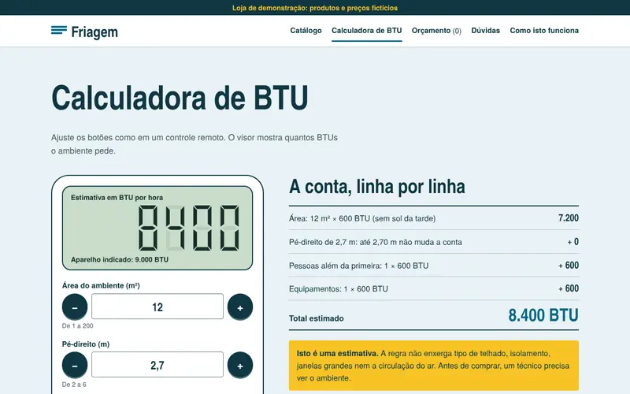

# Friagem Ar-condicionado (loja de demonstração)



Site demonstrativo de vendas de ar-condicionado, de uma loja fictícia em Cuiabá. A Friagem, as marcas, os modelos e os preços são inventados. Nada é vendido, enviado ou cobrado.

Publicado em: https://toshiro01001.github.io/ar-condicionado/

## O que tem no site

- **Calculadora de BTU**, em forma de controle remoto: área, pé-direito, pessoas, equipamentos e sol da tarde. Mostra a conta linha por linha, avisa que é uma estimativa e recomenda modelos do catálogo.
- **Catálogo** com Split, Split Inverter, Janela, Piso-teto e Cassete: filtros por BTU, tipo, tensão e faixa de preço, ordenação e comparação de até 3 modelos, com ilustrações próprias em SVG.
- **Orçamento e instalação**: valores de exemplo por tipo e distância de tubulação, carrinho, simulação de parcelas com juros de exemplo e pedido de visita com validação.
- **Dúvidas frequentes** sobre BTU, Inverter, instalação e manutenção.
- **Como isto funciona**: o que dá para adaptar e o que a versão real precisaria a mais.

## Como funciona

É um site estático de uma página só. As telas ficam em `index.html` e o JavaScript mostra uma de cada vez conforme o endereço (`#/catalogo`, `#/calculadora` e assim por diante). Não há servidor nem serviços de terceiros.

| Arquivo | Para que serve |
| --- | --- |
| `js/dados.js` | Catálogo, valores de instalação, juros e constantes da regra |
| `js/logica.js` | As contas, sem nada de tela |
| `js/app.js` | Telas, filtros, carrinho, formulário e rotas |
| `css/estilo.css` | Aparência |
| `fontes/` | Fontes TeX Gyre Heros, reduzidas e servidas pelo próprio site (licença GUST em `fontes/LICENCA-GUST.txt`) |
| `tests/fluxos.js` | Testes de ponta a ponta |

Carrinho, comparação, filtros e valores da calculadora ficam no `localStorage` do navegador. O formulário de visita não guarda nem envia nada.

A regra da calculadora: 600 BTU por m² (800 com sol da tarde), parte da área proporcional ao pé-direito acima de 2,70 m, mais 600 BTU por pessoa além da primeira e mais 600 BTU por equipamento. É uma estimativa e não substitui a avaliação de um técnico.

## Como rodar

Precisa de um servidor local simples, a partir da pasta do projeto:

```
python3 -m http.server 8000
```

Depois abra http://localhost:8000/.

Para rodar os testes, com Playwright e Chromium já instalados:

```
NODE_PATH=$(npm root -g) node tests/fluxos.js
```

Passe uma pasta como argumento para salvar as capturas de tela.

## Tecnologias

HTML, CSS e JavaScript puros, sem build e sem bibliotecas. SVG próprio nas ilustrações e no visor. Playwright apenas nos testes.

Desenvolvi este projeto e usei o Claude, da Anthropic, como ferramenta durante o desenvolvimento.
